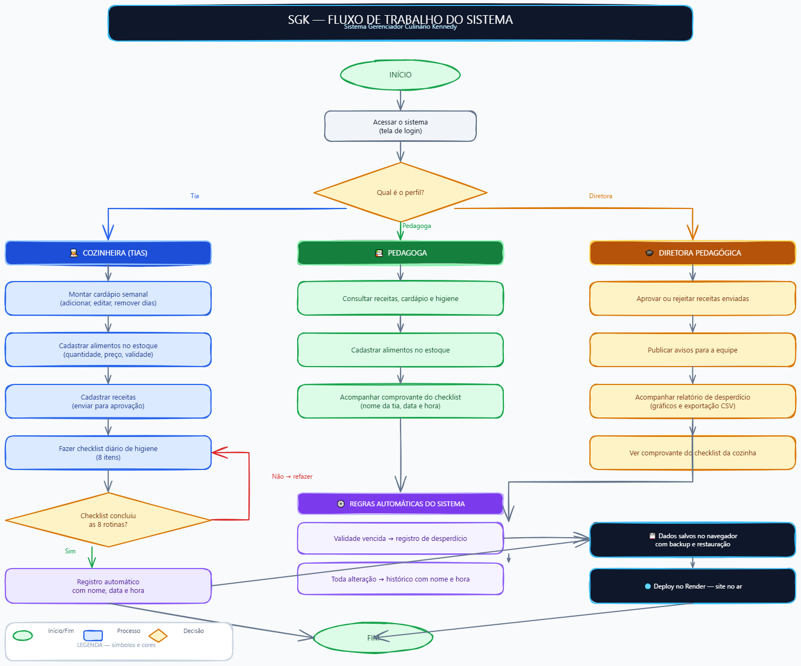
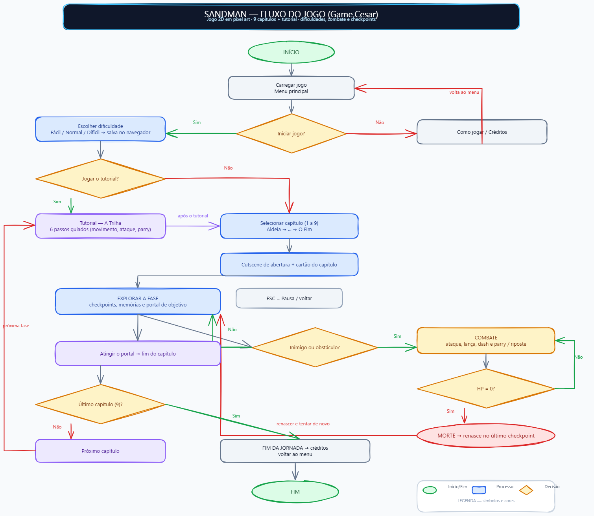

<div align="center">

# 🍽️ SGK — Sistema Gerenciador Culinário Kennedy

**Gestão inteligente da cozinha escolar**, direto no navegador.

[](https://sgk-kennedy.onrender.com)
[](https://sgk-kennedy.onrender.com)
[](#)
[](#licença)

[👉 **ABRIR O SISTEMA SGK** 👈](https://sgk-kennedy.onrender.com)

</div>

---

## 📌 Sobre o projeto

O **SGK** é um sistema de gestão para a cozinha da escola Kennedy. Reúne em um
só lugar as rotinas diárias: receitas passo a passo, cardápio semanal, controle
de estoque com preço e validade, checklist de higiene, avisos, aprovação de
receitas e relatório de desperdício.

> **Feito com carinho para quem cuida da alimentação na escola.** 💙

---

## 📑 Índice

| Seção | Conteúdo |
| --- | --- |
| [✨ Funcionalidades](#-funcionalidades) | O que o sistema faz |
| [👥 Perfis de acesso](#-perfis-de-acesso) | Quem faz o quê |
| [🔐 Acesso de teste](#-acesso-de-teste) | Contas para experimentar |
| [🚀 Como usar](#-como-usar) | Primeiros passos |
| [🛠️ Tecnologias](#️-tecnologias) | Stack do projeto |
| [📁 Estrutura](#-estrutura-do-projeto) | Arquivos e pastas |
| [📊 Fluxogramas](#-fluxogramas) | Diagramas do sistema e do jogo |
| [🔒 Segurança](#-segurança-e-qualidade) | Boas práticas adotadas |
| [💻 Rodar localmente](#-rodar-localmente) | Executar na sua máquina |
| [🌐 Publicação](#-publicação) | Deploy no Render |

---

## ✨ Funcionalidades

<div align="center">

| 📖 Receitas | 📅 Cardápio | 📦 Estoque | 🧼 Higiene |
| :---: | :---: | :---: | :---: |
| Mais de 1.000 receitas, com tempo de preparo, ingredientes, modo de preparo, vídeos e dicas de higiene | Montado pelas tias, com café, almoço, lanche e sobremesa | Quantidade, preço, validade e alertas de reposição e vencimento | Checklist diário das tias com comprovante para pedagoga e diretora |

| 📊 Relatório | 🔔 Avisos | ✅ Aprovação | 📝 Histórico |
| :---: | :---: | :---: | :---: |
| Desperdício mensal com gráficos, prejuízo estimado, sugestões e exportação CSV | Comunicações da direção para a equipe | Receitas enviadas pelas tias passam pela direção | Toda alteração registra quem fez, o quê e quando |

</div>

### Destaques

- ⚖️ **Desperdício pesado pelas cozinheiras**: registro diário com peso/quantidade, o que foi desperdiçado, motivo e prejuízo calculado pelo preço do estoque
- 🎯 **Metas de redução** semanal e mensal em kg, com barra de progresso e aviso quando a meta é ultrapassada
- 💡 **Sugestões inteligentes** baseadas nos dados reais (motivo principal, alimento mais perdido e distância da meta)
- 🍚 **Ícones automáticos no cardápio**: os emojis mudam conforme os alimentos escritos em cada refeição (arroz 🍚, frango 🍗, peixe 🐟, banana 🍌, bolo 🍰 e muitos outros)
- 🥚🐟 Categorias próprias de **ovos** e **peixes**, com vídeos de segurança alimentar
- 🚫 Itens com validade vencida viram **desperdício automaticamente** (sem duplicatas)
- 💾 **Backup e restauração** completa dos dados em JSON pelo rodapé
- ⚡ Buscas com **debounce** — fluidas mesmo com mais de mil receitas
- 🎨 Tema **Obsidian Blue** (preto e azul), com alternância para tema claro
- 📱 Interface responsiva com navegação inferior no celular
- ♿ Acessibilidade: navegação por teclado, foco gerenciado e rótulos em todos os controles

---

## 👥 Perfis de acesso

| Perfil | Responsabilidades |
| --- | --- |
| 👩‍🍳 **Cozinheira (tia)** | Monta o cardápio, faz o checklist diário, cadastra alimentos e envia receitas para aprovação |
| 📚 **Pedagoga** | Consulta receitas/cardápio/higiene, cadastra alimentos e acompanha os comprovantes da cozinha |
| 🎓 **Diretora Pedagoga** | Publica avisos, aprova receitas, acompanha o relatório de desperdício e vê os comprovantes |

> ⚠️ **Importante:** os dados ficam no `localStorage` do navegador. Não há
> servidor nem banco de dados — o comprovante de higiene e o histórico aparecem
> no **mesmo navegador/dispositivo** usado pela tia. O login é demonstrativo
> (feito no cliente). Para uso real com várias pessoas e dispositivos, seria
> necessário um backend com autenticação e banco de dados.

---

## 🔐 Acesso de teste

| Perfil | E-mail | Senha |
| --- | --- | --- |
| 👩‍🍳 Cozinheira | `cozinheira@kennedy.escola.br` | `kennedy123` |
| 📚 Pedagoga | `pedagoga@kennedy.escola.br` | `kennedy123` |
| 🎓 Diretora Pedagoga | `diretora@kennedy.escola.br` | `kennedy123` |

Ao escolher um perfil na tela de login, o e-mail é preenchido
automaticamente — digite apenas a senha. Também é possível criar novas contas
na aba **Criar conta**. Contas criadas ficam salvas e nunca são apagadas
automaticamente.

---

## 🚀 Como usar

1. Acesse o [SGK](https://sgk-kennedy.onrender.com)
2. Escolha seu perfil e entre com uma das contas de teste
3. Na **tela inicial**, veja atividade recente, avisos e atalhos
4. Use o **menu lateral** para navegar entre as seções
5. No rodapé, use **💾 Backup / Restaurar** para guardar seus dados

---

## 🛠️ Tecnologias

<div align="center">


</div>

- **Frontend:** HTML5 semântico, CSS3 (variáveis, grid, animações) e JavaScript vanilla
- **Persistência:** `localStorage` do navegador + backup/restore em JSON
- **Deploy:** Render (site estático)
- **Documentação:** README e fluxogramas em Excalidraw/draw.io

---

## 📁 Estrutura do projeto

```
Sistema-Aliment-cio-Kennedy/
├── 📄 README.md                    # Esta documentação
├── ⚙️ render.yaml                  # Blueprint de deploy no Render
├── 📂 .gitignore
├── 📂 docs/
│   └── 📂 fluxogramas/             # Diagramas do sistema e do jogo
│       ├── 🖼️ fluxograma-sgk.png
│       ├── 🖼️ fluxograma-sandman.png
│       ├── 📐 fluxograma-sgk.excalidraw
│       ├── 📐 fluxograma-sandman.excalidraw
│       └── 📐 fluxogramas-sgk-sandman.drawio
└── 📂 sgk-kennedy/                 # Site (publicado no Render)
    ├── 📄 index.html               # Estrutura e seções
    ├── 📄 404.html                 # Página de erro personalizada
    ├── 📄 favicon.svg              # Ícone da aba
    ├── 📄 robots.txt               # Regras para buscadores
    ├── 📄 sitemap.xml              # Mapa do site
    ├── 📂 css/
    │   └── styles.css              # Tema, componentes e responsividade
    └── 📂 js/
        ├── data.js                 # Dados iniciais (cardápio, receitas base)
        ├── receitas-extras.js      # Catálogo ampliado (1.000+ receitas)
        ├── receitas-ovos-peixes.js # Receitas de ovos e peixes
        ├── videos-data.js          # Vídeos usados dentro das receitas
        └── app.js                  # Lógica, perfis, sessão e interações
```

---

## 📊 Fluxogramas

### SGK — fluxo de trabalho do sistema



### Sandman — fluxo do jogo (Game.Cesar)



Os diagramas usam os símbolos corretos (elipse para início/fim, retângulo para
processo, losango para decisão) e estão disponíveis em
[`docs/fluxogramas/`](docs/fluxogramas/), nos formatos PNG, Excalidraw e draw.io.

---

## 🔒 Segurança e qualidade

- 🛡️ **Content Security Policy (CSP)** — bloqueia scripts inline, `eval` e origens não autorizadas
- 🔗 **URLs do YouTube validadas** — apenas IDs válidos de 11 caracteres
- 📄 **CSV protegido** contra injeção de fórmulas em planilhas
- ✍️ **Escape de conteúdo** de formulários antes de inserir no HTML
- ⚠️ **Tratamento global de erros** — falhas avisam o usuário sem quebrar a tela
- 🔒 **Armazenamento tolerante a falhas** — funciona mesmo se o `localStorage` estiver bloqueado
- ♿ **Acessibilidade** — foco gerenciado em modais, `aria-live`, `aria-current`, link "pular para o conteúdo" e `prefers-reduced-motion`
- ✨ **Acabamento visual** — animações sutis, tabelas com cabeçalho fixo e linhas zebradas, microinterações e feedback em botões

---

## 💻 Rodar localmente

```bash
# clone o repositório
git clone https://github.com/eduardoosganascimento-beep/Sistema-Aliment-cio-Kennedy.git
cd Sistema-Aliment-cio-Kennedy/sgk-kennedy

# inicie um servidor estático
python -m http.server 8000
# acesse http://localhost:8000
```

Também é possível abrir `sgk-kennedy/index.html` diretamente no navegador.

---

## 🌐 Publicação

O site está publicado no **Render** como site estático gratuito:

🔗 **https://sgk-kennedy.onrender.com**

O arquivo `render.yaml` permite recriar o serviço pelo botão **Deploy no Render**.
Se uma alteração não aparecer no ar, dispare um deploy manual pelo painel do
Render (`Manual Deploy → Deploy latest commit`).

---

## 📄 Licença

Projeto pessoal em desenvolvimento. Todos os direitos reservados.

---

<div align="center">

💙 **Feito com carinho para apoiar quem cuida da alimentação na escola.**

</div>
